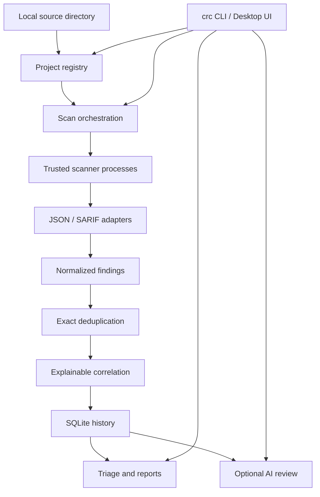

# CODE-REVIEW-CENTER

<p align="center">
  <strong>One review workspace. Multiple analysis engines. Findings you can act on.</strong>
  <br />
  A local-first code review center for local folders and GitHub repositories, trusted scanners, explainable findings, triage, and configurable AI review.
</p>

<p align="center">
  <a href="https://github.com/steno73mu/CODE-REVIEW-CENTER/actions/workflows/python-tests.yml"></a>
  
  
  
</p>

---

## What it does

CODE-REVIEW-CENTER brings multiple analysis tools into one traceable review workflow. It normalizes scanner output, deduplicates exact repeats, conservatively correlates cross-engine findings, stores scan history, supports reviewer triage, and can request an AI assessment of finding metadata.

This is an original product, not a repackaged scanner or a fork of another review application. External engines remain replaceable tools behind documented command-line, JSON, and SARIF interfaces.

## Implemented capabilities

- **Scanner adapters:** SARIF 2.1.0, Semgrep JSON, and Gitleaks JSON.
- **Finding model:** validation, provenance, source coordinates, stable SHA-256 fingerprints.
- **Deduplication and correlation:** deterministic exact deduplication plus conservative cross-engine matching with explicit pairwise evidence.
- **Safe process contract:** argument arrays only (no shell), per-engine timeouts, process-tree termination on cancellation/timeout, bounded output capture, and a maximum of 32 concurrent jobs.
- **Local persistence:** SQLite scan history, projects, scanner profiles, correlation evidence, AI reviews, and triage state.
- **Finding triage:** open, accepted, false positive, fixed, or won't-fix, with reviewer notes.
- **AI review:** OpenAI-compatible Chat Completions providers, local endpoints, environment-variable API key references, explicit remote-provider opt-in.
- **Reports:** JSON, SARIF 2.1.0, and Markdown exports.
- **Interfaces:** `crc` CLI and `crc-desktop` Tkinter desktop workspace.
- **GitHub repositories:** clone and update HTTPS GitHub repositories locally, then analyze them with the same scanner workflow.
- **Built-in presets:** Semgrep and Gitleaks.
- **Diagnostics:** `crc doctor` checks the local runtime and configured scanner executables without network access.

## Architecture



Both interfaces use the same application service and local database.

## Quick start

Requirements: Python 3.11 or newer. Install scanner executables separately; they are not bundled with this package.

### Install

Linux / Pop!_OS:

```bash
python3 -m venv .venv
source .venv/bin/activate
python -m pip install .
crc doctor
```

Windows PowerShell:

```powershell
py -3.11 -m venv .venv
.\.venv\Scripts\Activate.ps1
python -m pip install .
crc doctor
```

### Add a local folder or GitHub repository

Register a folder already on your computer, or clone a GitHub repository into CODE-REVIEW-CENTER's private application data folder. The source checkout, scan results, and history stay on your computer. Git must be installed. Public repositories work without credentials; private repositories require Git credentials already configured for Git.

```bash
crc project add --name my-project --path /path/to/repository
crc project clone --url https://github.com/owner/repository --name my-project --branch main
crc project list
crc project update PROJECT_ID
```

The desktop workspace also provides **Add GitHub** and **Update** actions in the projects panel. Updating uses a fast-forward-only pull and leaves locally modified files untouched.

### Register scanners and run a review

```bash
crc scanner preset add semgrep
crc scanner preset add gitleaks
crc scanner preset add trivy
crc scanner preset add osv-scanner
crc project list
crc scan --project PROJECT_ID
crc history list
```

Copy the `project_id` from `crc project list` and replace `PROJECT_ID` above. Semgrep must be installed and available on `PATH`. The Gitleaks preset requires Gitleaks 8.19 or newer and requests fully redacted JSON on stdout using the upstream [Gitleaks CLI report-path convention](https://github.com/gitleaks/gitleaks#commands). The Trivy preset scans filesystem vulnerabilities and misconfigurations and emits SARIF; it leaves secret detection to Gitleaks so secret match text is not copied into the shared finding record. The OSV-Scanner preset emits SARIF for dependency vulnerability findings. Both tools are optional external installations, and their database/network requirements depend on the tools' configuration.

### Open the desktop workspace

```bash
crc-desktop
```

The desktop workspace supports project and scanner/provider profiles, background scans, cancellation, finding triage, AI review, history, and report export. On Windows, `crc-desktop` is installed as a GUI script and does not open an extra console window. On Linux, install the matching `python3-tk` package if Tkinter is not included with your Python interpreter.

### Configure a custom scanner

Scanner profiles use argument arrays, never shell command strings. The only supported substitution is the standalone `{project_path}` argument.

```bash
crc scanner add --id custom-semgrep --name "Semgrep custom" --parser semgrep \
  --command-json '["semgrep", "scan", "--json", "--quiet", "{project_path}"]' --exit-codes 0
```

Only configure trusted, locally installed scanner executables. CODE-REVIEW-CENTER does not execute project scripts, hooks, or build commands.

## AI review

Provider profiles use the OpenAI-compatible Chat Completions API. For a local Ollama endpoint, for example:

```bash
crc provider add --id local --name "Local model" \
  --url http://127.0.0.1:11434/v1 --model YOUR_LOCAL_MODEL
crc review --session SESSION_ID --provider local
```

API keys are referenced by environment-variable name and are never stored in SQLite. Remote providers must use HTTPS and require explicit opt-in:

```bash
export REVIEW_API_KEY="..."
crc provider add --id remote --name "Remote reviewer" \
  --url https://provider.example/v1 --model MODEL_NAME --api-key-env REVIEW_API_KEY
crc review --session SESSION_ID --provider remote --allow-external
```

AI review sends finding metadata, including scanner messages, but does not upload source files or code excerpts. Review responses are stored in local scan history. Assess the sensitivity of finding messages before using a remote provider.

## Triage and reports

```bash
crc triage list --session SESSION_ID
crc triage set --session SESSION_ID --fingerprint SHA256 --status fixed --note "Verified in patch"
crc report --session SESSION_ID --format sarif --output review.sarif
crc report --session SESSION_ID --format markdown --output review.md
```

Supported report formats are JSON, SARIF 2.1.0, and Markdown. Existing output files are not overwritten unless `--force` is supplied.

## Security boundaries

- The scanner launcher is **not a sandbox**. Configure only trusted local executables. Bare executable names are resolved from absolute `PATH` directories before entering the project directory; relative `PATH` entries are ignored, and scanner executables inside the analyzed project are rejected. Timeouts and cancellation terminate the scanner process tree (POSIX process groups; Windows `taskkill /T`).
- Output capture is 1 MiB per stream by default (hard maximum 64 MiB); raw stdout/stderr are not persisted.
- Gitleaks preset requests 100% redaction, and the adapter excludes secret and matched-text fields from normalized findings.
- Remote AI review requires explicit opt-in, HTTPS, public destination addresses, and bounded request/response sizes. API keys stay in environment variables. This is not a substitute for network egress controls.
- Application data is stored in a private per-user directory (POSIX mode 0700).
- Public pull-request CI runs on GitHub-hosted Linux/Windows runners; the self-hosted Pop!_OS runner is not used for untrusted PR code.

## Current status and release readiness

This is a functional MVP in early development, not yet a production release. CI builds and installs wheel and source-distribution artifacts on Linux and Windows with Python 3.11-3.13, and smoke-tests Tk workspace startup on Linux (Xvfb) and Windows. Manual interactive usability testing is still required. The desktop interface still needs interactive testing on real Pop!_OS and Windows desktops. Cross-engine correlation needs a larger labeled fixture corpus, and the scanner presets need validation against real installed scanner versions.

**Licensing:** no repository license has been selected yet. Public visibility does not grant permission to reuse or redistribute this project's code. A license decision and third-party license/notice audit are required before a formal open-source release.

See [docs/release-readiness.md](docs/release-readiness.md) for the full release checklist and [docs/third-party-integrations.md](docs/third-party-integrations.md) for upstream scanner licensing and integration boundaries.

## Contributing

See [CONTRIBUTING.md](CONTRIBUTING.md), [SECURITY.md](SECURITY.md), [docs/architecture/overview.md](docs/architecture/overview.md), and [CHANGELOG.md](CHANGELOG.md).

## Principles

- Own the finding model, orchestration, correlation, persistence, and user experience.
- Integrate mature tools through focused, documented interfaces; do not copy whole third-party applications.
- Preserve evidence and provenance; do not silently merge severity or erase scanner results.
- Review licenses, notices, transitive dependencies, security, and platform compatibility before adopting components.