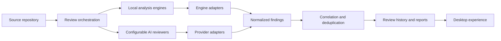

# CODE-REVIEW-CENTER

<p align="center">
  <strong>One review workspace. Multiple analysis engines. Findings you can act on.</strong>
  <br />
  An independent desktop code-review center designed to bring local scanners and configurable AI reviewers into one clear, traceable workflow.
</p>

<p align="center">
  <a href="https://github.com/steno73mu/CODE-REVIEW-CENTER/actions/workflows/python-tests.yml"></a>
  
  
  
</p>

---

## Why this project?

Modern code review can involve several disconnected tools: static analysis, secret detection, dependency checks, and AI-assisted review. Their outputs differ, overlap, and are difficult to compare consistently.

**CODE-REVIEW-CENTER is being built to bring that work together.**

The goal is not another wrapper around a single scanner. It is an independent product that owns the review workflow, the common finding model, correlation, history, provider configuration, and the experience developers use to investigate and resolve issues.

## What makes it different

- **Engine-independent:** connect replaceable analysis tools through explicit adapters.
- **One consistent language:** normalize heterogeneous diagnostics into a common finding model.
- **Traceable evidence:** retain source identity, rule information, locations, and diagnostic context.
- **Security-conscious by design:** secret values detected by Gitleaks are discarded rather than copied into normalized findings.
- **AI reviewers as collaborators:** the planned provider layer will make AI review configurable rather than tied to one vendor.
- **Our architecture, our product:** open-source projects are studied for focused integration opportunities; the product's core and direction remain original.

## How the pieces fit together



*Conceptual target architecture. Components beyond the current core are planned, not yet implemented.*

## Current status

<details open>
<summary><strong>Implemented in the current core</strong></summary>

- Immutable, tool-independent finding model.
- Stable SHA-256 finding fingerprints.
- SARIF 2.1.0 parser.
- Native Semgrep JSON adapter.
- Native Gitleaks JSON adapter, excluding secret values and matched source text.
- Deterministic exact-fingerprint deduplication.
- Trusted external-engine process runner using argument arrays (no shell), execution timeouts, and captured diagnostics.\n- Generic scanner invocation that parses stdout into normalized findings and preserves process evidence.\n- Concurrent multi-scanner batches with deterministic result ordering, isolated failures, per-engine timeouts, cooperative cancellation, and aggregate exact deduplication.\n- Transactional SQLite scan history with per-engine outcomes, normalized findings, validated session IDs, and paginated history.
- Automated Python unit tests and GitHub Actions workflow.

</details>

<details>
<summary><strong>Under development / planned</strong></summary>

- Scan orchestration, including lifecycle, concurrency, cancellation, and output-size policies.
- Project and review-history persistence.
- Explainable cross-engine finding correlation.
- Configurable AI-provider management and review orchestration.
- Desktop interface, triage workflow, and actionable reports.

</details>

This repository is in **early development**. It is not yet a complete desktop application and is not recommended for production use.

## Quick start

Requirements: Python 3.11 or newer.

```bash
git clone https://github.com/steno73mu/CODE-REVIEW-CENTER.git
cd CODE-REVIEW-CENTER

PYTHONPATH=src python -m unittest discover -s tests -v
```

The current core uses the Python standard library at runtime. The same compile and unit-test checks are configured in GitHub Actions.

## Project principles

| Principle | What it means |
|---|---|
| Own the intelligence layer | Normalization, correlation, orchestration, history, and UX belong to this project. |
| Integrate before reimplementing | Prefer mature tools through documented CLI, JSON, or SARIF interfaces. |
| Keep components replaceable | No scanner or model provider should become an irreplaceable dependency. |
| Preserve evidence | Findings must remain explainable and traceable to their source. |
| Protect sensitive data | Avoid retaining secrets or unnecessary copies of sensitive source content. |
| Review before reuse | Check licenses, notices, transitive dependencies, security, and platform compatibility before adopting components. |

## Get involved

Ideas, architecture feedback, bug reports, and focused contributions are welcome.

- Open an [issue](https://github.com/steno73mu/CODE-REVIEW-CENTER/issues) to discuss a problem or proposal.
- Review the [open pull requests](https://github.com/steno73mu/CODE-REVIEW-CENTER/pulls) to see work in progress.
- Read the [architecture overview](docs/architecture/overview.md) before proposing changes to the core.

We especially value contributions that improve correctness, explainability, security, portability, and developer experience.

## Architecture and development notes

See [docs/architecture/overview.md](docs/architecture/overview.md) for module boundaries, integration rules, and the implementation sequence.

---

<p align="center">
  <strong>Built independently. Designed to make code review clearer, safer, and more actionable.</strong>
</p>
