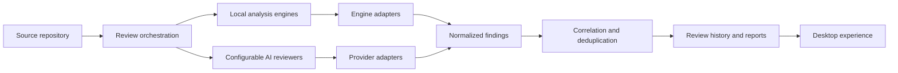

# CODE-REVIEW-CENTER

<p align="center">
  <strong>One review workspace. Multiple analysis engines. Findings you can act on.</strong>
  <br />
  An independent desktop code-review center designed to bring local scanners and configurable AI reviewers into one clear, traceable workflow.
</p>

<p align="center">
  <a href="https://github.com/steno73mu/CODE-REVIEW-CENTER/actions/workflows/python-tests.yml"></a>
  
  
  
</p>

---

## Why this project?

Modern code review can involve several disconnected tools: static analysis, secret detection, dependency checks, and AI-assisted review. Their outputs differ, overlap, and are difficult to compare consistently.

**CODE-REVIEW-CENTER is being built to bring that work together.**

The goal is not another wrapper around a single scanner. It is an independent product that owns the review workflow, the common finding model, conservative explainable correlation, history, provider configuration, and the experience developers use to investigate and resolve issues.

## What makes it different

- **Engine-independent:** connect replaceable analysis tools through explicit adapters.
- **One consistent language:** normalize heterogeneous diagnostics into a common finding model.
- **Traceable evidence:** retain source identity, rule information, locations, and diagnostic context.
- **Security-conscious by design:** secret values detected by Gitleaks are discarded rather than copied into normalized findings.
- **AI reviewers as collaborators:** the planned provider layer will make AI review configurable rather than tied to one vendor.
- **Our architecture, our product:** open-source projects are studied for focused integration opportunities; the product's core and direction remain original.

## How the pieces fit together



*Conceptual target architecture. Components beyond the current core are planned, not yet implemented.*

## Current status

<details open>
<summary><strong>Implemented in the current core</strong></summary>

- Immutable, tool-independent finding model.
- Stable SHA-256 finding fingerprints.
- SARIF 2.1.0 parser.
- Native Semgrep JSON adapter.
- Native Gitleaks JSON adapter, excluding secret values and matched source text.
- Deterministic exact-fingerprint deduplication.
- Conservative cross-engine correlation requiring the same file and line plus a high message-similarity score, with explicit pairwise evidence.
- Trusted external-engine process runner using argument arrays (no shell), execution timeouts, bounded output capture, and process cancellation.
- Generic scanner invocation that parses stdout into normalized findings and preserves process evidence.
- Concurrent multi-scanner batches with deterministic result ordering, isolated failures, per-engine timeouts, running-process cancellation, bounded output capture, and aggregate exact deduplication.
- Transactional SQLite scan history with per-engine outcomes, normalized findings, validated session IDs, and paginated history.
- Local project registry with stable IDs, canonical directory paths, duplicate protection, and rename/list/remove operations.
- Validated, allowlisted scanner profiles stored in SQLite.
- `crc` command-line application for project management, scanner configuration, scans, AI reviews, history, and report export.
- `crc-desktop` local desktop workspace for projects, scanner/provider profiles, background scans, finding triage, AI review, history, and report export.
- OpenAI-compatible provider profiles and AI finding reviews through `crc provider` and `crc review` commands.
- Automated Python unit tests and GitHub Actions workflow.

</details>

<details>
<summary><strong>Under development / planned</strong></summary>

- Advanced triage actions, code-context navigation, rich evidence comparison, and report export.
- Configurable AI-provider management and review orchestration.
- Advanced triage actions, code-context navigation, rich evidence comparison, report export, and AI-assisted review.

</details>

This repository is in **early development**. The local CLI and first desktop workspace are usable for controlled experiments. Advanced triage, AI review, report export, and full platform validation remain in development; the project is not recommended for production use.

## Quick start

Requirements: Python 3.11 or newer.

```bash
git clone https://github.com/steno73mu/CODE-REVIEW-CENTER.git
cd CODE-REVIEW-CENTER
python -m pip install .
crc doctor
python -m unittest discover -s tests -v
```

The current core uses the Python standard library at runtime. Install the CLI and desktop launcher with `python -m pip install .`. The same compile, CLI smoke-test, desktop-module import, and unit-test checks are configured in GitHub Actions.

Launch the desktop workspace with:

```bash
crc-desktop
```

On Linux distributions where Tkinter is packaged separately, install the matching `python3-tk` package for the Python interpreter in use. The desktop workspace provides local project registration, scanner profile management, background scan execution with cancellation, finding review, and scan history. It binds to no network port and stores local state in the application data directory.

Register a source directory and add the built-in Semgrep preset (the Semgrep executable must already be installed and available on PATH):

```bash
crc project add --name my-project --path /path/to/repository
crc scanner preset add semgrep
crc scan --project PROJECT_ID
```

For custom scanners, configure an explicit trusted argument array (example for Semgrep on Linux/macOS):

```bash
crc project add --name my-project --path /path/to/repository
crc scanner add --id semgrep --name Semgrep --parser semgrep \
  --command-json '["semgrep", "scan", "--json", "--quiet", "{project_path}"]'
crc project list
# Copy the project_id from the output, then:
crc scan --project PROJECT_ID
crc history list

# Optional local AI review (Ollama / LM Studio OpenAI-compatible endpoint):
crc provider add --id local --name "Local model" \
  --url http://127.0.0.1:11434/v1 --model YOUR_LOCAL_MODEL
crc review --session SESSION_ID --provider local

# Export the saved session as SARIF for other code-scanning tools:
crc report --session SESSION_ID --format sarif --output review.sarif
```

Scanner profiles accept argument arrays, not shell command strings. The only supported substitution is the standalone `{project_path}` argument. Configure only trusted, locally installed scanner binaries; never place credentials in command arguments. Output capture is bounded per stream (1 MiB by default), and scan history stores normalized findings and execution metadata, not raw stdout/stderr.

AI provider profiles use the OpenAI-compatible Chat Completions API. API keys are referenced by environment-variable name and never stored in SQLite. Loopback HTTP endpoints are supported for local models; remote endpoints must use HTTPS and require the explicit `--allow-external` flag at review time. Only finding metadata is sent—no source files or code excerpts are uploaded. Review responses are saved in the local scan history. Application data is kept in a private per-user directory (POSIX mode 0700). Export saved sessions as JSON, SARIF 2.1.0, or Markdown with `crc report`; the desktop History tab also offers report export. Existing output files are not overwritten unless explicitly confirmed.

## Finding triage

Finding dispositions are stored per scan session: `open`, `accepted`, `false_positive`, `fixed`, or `wont_fix`. Use `crc triage list --session SESSION_ID` to inspect them and `crc triage set --session SESSION_ID --fingerprint SHA256 --status fixed --note "Verified in patch"` to update one. Triage state is included in JSON/SARIF/Markdown exports.

## Release readiness

The MVP-to-release checklist, including licensing and manual desktop validation, is in [docs/release-readiness.md](docs/release-readiness.md).

## Project principles

**Licensing note:** no repository license has been selected yet. Until a license is added, public visibility does not grant permission to reuse or redistribute this project's code.

| Principle | What it means |
|---|---|
| Own the intelligence layer | Normalization, correlation, orchestration, history, and UX belong to this project. |
| Integrate before reimplementing | Prefer mature tools through documented CLI, JSON, or SARIF interfaces. |
| Keep components replaceable | No scanner or model provider should become an irreplaceable dependency. |
| Preserve evidence | Findings must remain explainable and traceable to their source. |
| Protect sensitive data | Avoid retaining secrets or unnecessary copies of sensitive source content. |
| Review before reuse | Check licenses, notices, transitive dependencies, security, and platform compatibility before adopting components. |

## Get involved

Ideas, architecture feedback, bug reports, and focused contributions are welcome.

- Open an [issue](https://github.com/steno73mu/CODE-REVIEW-CENTER/issues) to discuss a problem or proposal.
- Review the [open pull requests](https://github.com/steno73mu/CODE-REVIEW-CENTER/pulls) to see work in progress.
- Read the [architecture overview](docs/architecture/overview.md) before proposing changes to the core.

We especially value contributions that improve correctness, explainability, security, portability, and developer experience.

## Architecture and development notes

See [docs/architecture/overview.md](docs/architecture/overview.md) for module boundaries, integration rules, and the implementation sequence.

---

<p align="center">
  <strong>Built independently. Designed to make code review clearer, safer, and more actionable.</strong>
</p>
